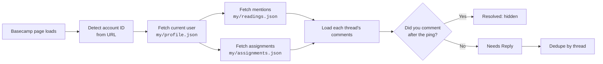

<div align="center">

# Basecamp Needs Reply

**Never lose track of a Basecamp ping again.**

A lightweight Chromium extension that adds a **Needs Reply** tab next to Basecamp's **My Tasks**: every mention and assignment you still haven't answered, in one place.

[](https://developer.chrome.com/docs/extensions/develop/migrate/what-is-mv3)
[](#installation)
[](#installation)
[](#installation)
[](manifest.json)
[](LICENSE)
[](#privacy--permissions)

</div>

---

## Why?

Basecamp tells you when someone **@mentions** you. It doesn't tell you which of those mentions you **haven't answered yet**. Notifications pile up, get marked as read, and the question you meant to come back to slips through.

**Needs Reply** reads each thread and shows only the ones where someone pinged you and you haven't posted a comment since.

## Features

- **Native-feeling tab.** Sits beside **My Tasks** in Basecamp's bottom tray and shows a live count badge.
- **Reply-aware filtering.** Shows a mention only when you have **not** commented after it in the same thread.
- **Covers more than comments.** Includes mentions in card, to-do, message and document bodies, plus your active to-do and card assignments.
- **Deduplicated.** Several pings in one thread become a single entry that points at the latest one.
- **Opens instantly.** Cached results appear right away while a refresh runs in the background (stale-while-revalidate). Fetches run in parallel and back off politely when Basecamp rate-limits.
- **Local Ignore.** Hide a thread until it gets new activity. You can review ignored threads with **Show all**.
- **Synced across tabs.** Refreshes and Ignore actions appear in every open Basecamp tab.
- **Theme-matched.** Uses Basecamp's own CSS variables, so it follows the light or dark theme.
- **Read-only.** Never posts, edits or marks anything as read in Basecamp.

## How it works



The core rule:

```js
const needsReply =
  mention.creator.id !== CURRENT_USER_ID &&
  !thread.comments.some(comment =>
    comment.creator.id === CURRENT_USER_ID && isAfter(comment, mention.focus)
  );
```

The extension uses the Basecamp session you are already logged into, so there are **no API tokens or OAuth setup**. Your account and user are detected automatically.

## Installation

> The extension isn't in the Chrome Web Store yet. Load it unpacked in developer mode.

1. Clone the repository:
   ```bash
   git clone https://github.com/x4nk1t/basecamp-needs-reply-ext.git
   ```
2. Open your browser's extensions page:
   | Browser | URL |
   |---|---|
   | Chrome | `chrome://extensions` |
   | Brave | `brave://extensions` |
   | Edge | `edge://extensions` |
3. Turn on **Developer mode**.
4. Click **Load unpacked** and select the cloned folder.
5. Open or reload Basecamp while logged in. **Needs Reply** appears beside **My Tasks** in the bottom tray.

To update, run `git pull` and click the **reload** icon on the extension card.

## Usage

| Action | What it does |
|---|---|
| **Needs Reply** tab | Opens the panel. The badge shows how many threads are waiting on you. |
| **Open in Basecamp** | Jumps straight to the comment or recording that pinged you. |
| **Ignore** | Hides the thread on this browser only. It comes back if the thread gets newer activity. |
| **Active / Show all** | Switches between unresolved items and everything, including ignored items. |
| **Refresh** | Fetches fresh data from Basecamp right away. |
| <kbd>Esc</kbd> | Closes the panel. |

## Settings

Open the options page from the extensions page (**Details → Extension options**).

| Setting | Default | Description |
|---|---|---|
| Fallback account ID | *auto* | Used only if the account can't be detected from the URL. |
| Fallback person ID | *auto* | Used only if `my/profile.json` can't be read. |
| Time window | `7` days | How far back to look for mentions and assignments (1–30). |
| Read notification pages | `3` | How many pages of already-read notifications to scan (1–10). |
| Preferred host | `app.basecamp.com` | `app.basecamp.com` or `3.basecamp.com`. |

## Privacy & permissions

| Permission | Why |
|---|---|
| `storage` | Caches results, settings and your local Ignore list in `chrome.storage.local`. |
| `https://app.basecamp.com/*`<br/>`https://3.basecamp.com/*` | Reads Basecamp's JSON endpoints using your existing session. |

- **No external servers.** Data goes only between your browser and Basecamp.
- **No analytics or tracking.**
- **Read-only.** The extension only makes `GET` requests. It never posts comments, changes recordings or marks notifications as read.
- **Nothing hardcoded.** Account and user IDs are detected at runtime, so it works for any Basecamp user.

## Project structure

```text
manifest.json                  MV3 manifest
src/
├── background/
│   └── service-worker.js      Cache, refresh coordination, ignore state
├── content/
│   ├── content-script.js      Injects the tab and renders the panel
│   └── content-style.css      Basecamp-themed styles
├── shared/
│   └── basecamp-engine.js     Fetching, reply detection, dedupe
└── options/
    ├── options.html           Settings page
    ├── options.js
    └── options.css
```

The extension has no build step, bundler or dependencies. It is plain JavaScript that runs as-is.

## Known limitations

- Basecamp doesn't officially support custom UI. If its layout changes, the extension falls back to a floating button.
- It relies on Basecamp's internal app JSON endpoints rather than the official OAuth API, so those endpoints could change without notice.
- Supported recording types are cards, to-dos, messages and documents. Other types are skipped.
- One Basecamp account is supported at a time: the one in the current tab's URL.

## Contributing

Issues and pull requests are welcome. Please keep the extension **read-only** against Basecamp, and don't commit account IDs, user IDs or screenshots of private data.

1. Fork the repo and create a branch.
2. Load your fork unpacked and test it on a real Basecamp account.
3. Open a PR that describes what changed and why.

## License

Released under the [MIT License](LICENSE).

<div align="center">
<sub>Not affiliated with or endorsed by Basecamp or 37signals.</sub>
</div>
